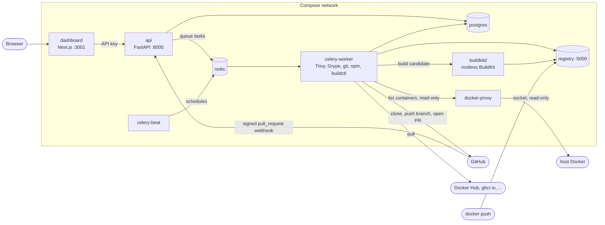
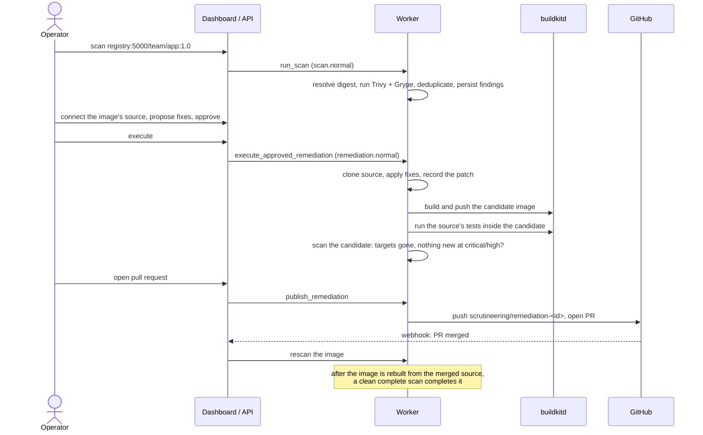
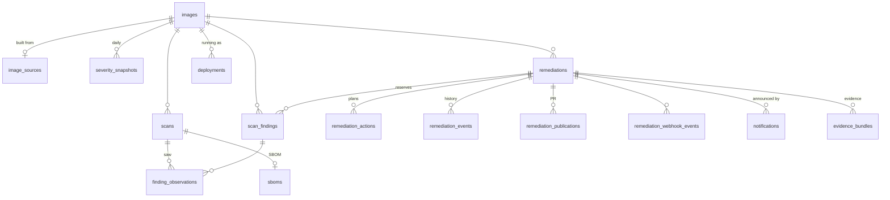
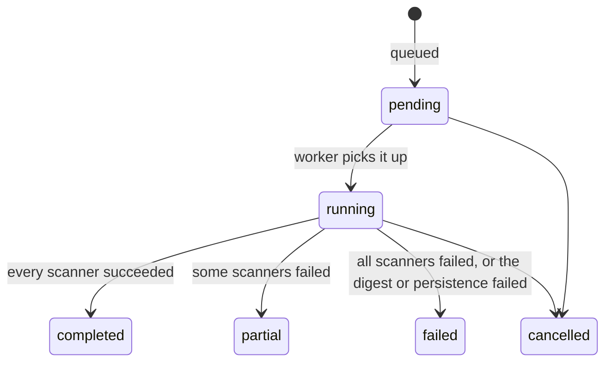
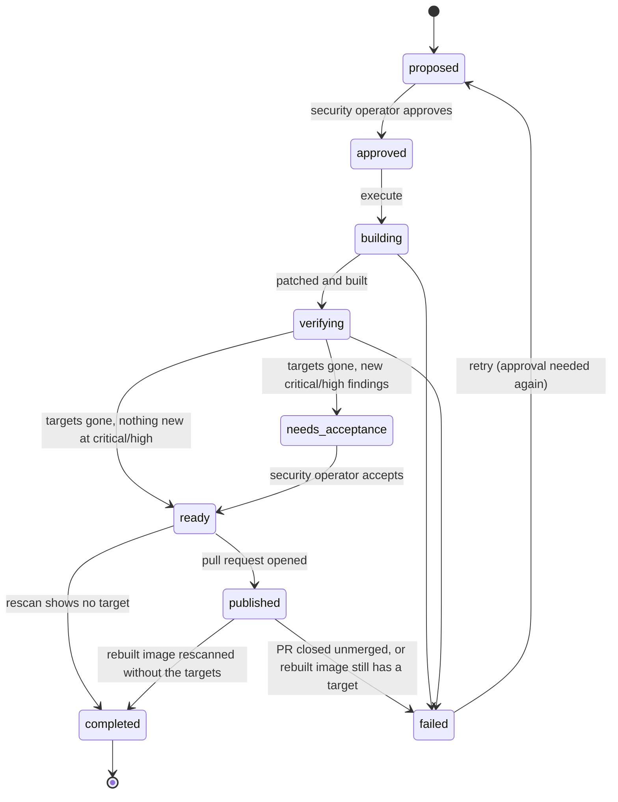

# Architecture

Scrutineering runs one loop: an image is pushed or discovered, scanned, and its
findings tracked. An operator then proposes a fix, Scrutineering builds and verifies
a patched image, opens a pull request, and marks the fix completed once a rescan of
the rebuilt image shows it worked. This page shows the services that run the loop,
the data it keeps, and the state machines that drive it. Settings are listed in
[CONFIGURATION.md](CONFIGURATION.md).

## Services

- **`dashboard`**: the web UI. Its server-side routes proxy every request to the API
  with the API key, so browsers never hold it.
- **`api`**: the dashboard API (`/api/dashboard/...`). It reads and writes the
  database, queues work, and receives the GitHub webhook. It never scans or builds.
- **`celery-worker`**: runs scans (Trivy and Grype side by side) and remediations
  (clone, patch, build, scan the candidate, publish), and sends notifications. It
  consumes the queues `scan.high`, `scan.normal`, `scan.low`, `remediation.normal`
  and `notify`.
- **`celery-beat`**: queues scheduled rescans of known images (`SCHEDULE_CRON_SCAN`),
  runtime discovery every 15 minutes when enabled, the notification delivery and
  evidence sweeps every minute, the stale-deployment notification sweep every 15
  minutes, the weekly report (`REPORT_SCHEDULE_CRON`), daily prunes of superseded SBOMs,
  gone containers, people unseen for a year and old candidates, and an hourly prune of
  compliance exports.
- **`postgres`**: all state. Alembic manages the schema (`src/db/migrations`).
- **`redis`**: Celery's broker and result backend, plus an optional shared scan cache.
- **`registry`**: a local OCI registry. Push to `localhost:5000`; the services reach it
  as `registry:5000`. Candidate images are pushed here too.
- **`docker-proxy`**: a read-only Docker API for runtime discovery. It mounts the
  host's socket read-only, allows only listing and inspecting containers and
  images, and sits on an internal network that only the worker joins.
- **`buildkitd`**: rootless BuildKit. The worker builds candidate images through it
  over TCP, so nothing mounts the Docker socket.

## The loop

## Data model

`principals` and `audit_log` stand alone: they name people by their sign-in subject.

- **`images`**: one row per repository and tag, with the last digest seen, and
  when runtime discovery last saw it running (`last_seen_running_at`). An
  `image_sources` row says which repository, ref, Dockerfile and build context the
  image is built from.
- **`scans`**: one row per scan run. It records the target, the digest it scanned, the
  scanner and database versions, its status and phase, and the finding count.
- **`scan_findings`**: one row per vulnerable package version on an image, tracked
  across scans. Two keys identify it:
  - `fingerprint` (CVE + package + version): the identity of the row.
  - `vuln_key` (CVE + package): asks "is this CVE still in this package, at any
    version?". Remediations target `vuln_key`s, so upgrading a package resolves
    them even though its new version is a different fingerprint.
- **`finding_observations`**: what each scan saw. A scan's findings page reads these,
  so history is never rewritten.
- **`severity_snapshots`**: one row per image per day, for the trend charts.
- **`remediations`**: a fix for selected findings on one image. It holds the planned
  actions, then what execution produced: `source_commit`, `patch`,
  `candidate_image`/`candidate_digest`, and `verification` (the candidate scan
  compared with the targets). While open, it reserves its findings
  (`scan_findings.remediation_id`), so a finding is in at most one open remediation.
  `proposed_by`, `approved_by`, `executed_by`, `accepted_by` and `published_by`
  record who took each step, for separation of duties.
- **`remediation_publications`**: the GitHub pull request. It holds the provider
  (`github`), repository, branch, base, head commit, number, status (`open`, `merged`, `closed`, `failed`) and the image
  digest when it was opened.
- **`sboms`**: the CycloneDX SBOM of a completed or partial image scan, stored
  exactly as Trivy wrote it, with its SHA-256 and component count. Each image keeps
  its newest; a daily sweep removes the rest.
- **`evidence_bundles`**: a remediation's frozen, signed evidence, one per ending
  (`completed` or `failed`), built by a sweep every minute from server records only.
  The SBOMs of the scans it cites are kept.
- **`deployments`**: one row per container of a scannable image that runtime
  discovery saw (Docker only): name, reference, the digests of the build it runs,
  and when it started. `gone_at` is set when a run no longer lists the container;
  a daily sweep deletes rows gone for 30 days. Whether it runs the latest scanned
  build is derived when read.
- **`reports`**: signed weekly and on-demand reports as canonical JSON
  (`scrutineering.report/v1`), one per week (`REPORT_SCHEDULE_CRON`), kept
  indefinitely.
- **`compliance_exports`**: requested exports (`pending`, `building`, `ready`,
  `failed`) and, once built, the zip itself. An hourly sweep deletes them after 24 hours.
- **`signing_keys`**: every public key this instance has signed exports with. The
  private key is only on the worker (`src/signing.py`); each SBOM records its
  signature and `key_id`.
- **`notifications`**: an outbox. Every remediation status change in
  `NOTIFICATION_EVENTS`, every scan that finds a new critical CVE, and every unattended
  scan failure that starts a run of failures, writes one row per configured channel, in
  the same transaction, with the message's payload. Each row has its own delivery status:
  `pending`, then `sent` or (after five attempts) `failed`. Sent rows are deleted
  after 30 days.
- **`principals`**: everyone the forward-auth proxy has signed in: subject, email,
  roles at their last sign-in, and when they were first and last seen (written at
  most hourly per person). A daily sweep removes people unseen for a year.
- **`remediation_events`** and **`audit_log`**: history. Remediation events are the
  timeline of one remediation; the audit log records operator actions and scan
  lifecycle. Neither is read to decide current state.

## State machines

Each entity has one status column. Code changes it only through the transitions
below.

### Scans

Every scan records what it saw, and a resolved finding that shows up again is
reopened (`reopened_at`). Only a **completed** scan, the only kind known to have
seen everything, does the rest:

- A finding it did not see gets `resolved_at`.
- A daily severity snapshot is written.
- Ready and published remediations are checked for completion.

A partial scan never resolves anything.

### Remediations

Every status except `completed` and `cancelled` can also be **cancelled**, which releases the
remediation's findings so they can be proposed again.

The transitions live in `src/remediation/state_machine.py`. The server decides every
step from what it cloned, built and scanned itself:

- The worker moves a remediation through `building` and `verifying`.
- `completed` and the rebuilt-image `failed` come from the server's own complete
  scans (`src/remediation/lifecycle.py`).
- The webhook contributes only whether the pull request was merged or closed.

## Trust boundaries

- **Browser to API.** Only through the dashboard's server-side proxy, which adds the
  API key. With `DASHBOARD_AUTH_MODE=trusted-proxy`, a forward-auth proxy signs
  users in and the ingress forwards their identity with
  `DASHBOARD_TRUSTED_PROXY_SECRET`. The API then requires that identity on every
  dashboard request (`401 identity_required` without it) and maps the user's
  groups to roles (`DASHBOARD_GROUP_ROLES`). A user with no role is refused
  (`403 no_role`). In `local` mode every session gets `DASHBOARD_DEFAULT_ROLES`.
  Internal services can sign requests (`SERVICE_AUTH_SECRET`).
- **Other sites.** The dashboard refuses state-changing requests (anything but GET,
  HEAD and OPTIONS) that a browser marks as coming from another site
  (`Sec-Fetch-Site`, or an `Origin` that doesn't match the host), with
  `403 cross_site_request_refused`. Without this, any page a user visited could
  approve or publish a remediation through their dashboard. Requests with neither
  header (curl, scripts) are not from a browser and are allowed.
- **Roles.** One matrix in `src/api/roles.py` maps each action to the roles that
  hold it, and each route checks one action (see the
  [API reference](api/dashboard-v1.md)).
  - Every role reads posture, scans, images and findings.
  - `operator` starts and cancels scans, archives images and triages findings.
  - `remediator` connects sources and proposes, executes and cancels remediations.
  - `security-operator` holds both of those, plus approve, accept new findings,
    publish, retry, the audit and compliance exports, and notifications.
  - `admin` holds every action, including building reports and seeing people.
- **Separation of duties.** With `REMEDIATION_SEPARATE_APPROVER` on (the default
  when people sign in), whoever proposed a remediation can't approve it or accept
  its new findings (`403 separate_approver_required`).
- **GitHub to API.** The webhook route is the one exception to API-key
  authentication. It requires GitHub's HMAC signature (`GITHUB_WEBHOOK_SECRET`) and
  ignores repeated delivery IDs.
- **No client-asserted facts.** Digests, finding counts and verification results are
  never accepted from a request. They come from the worker's own scans.
- **Signing key.** The private key that signs exports exists only on the worker's
  `signingkeys` volume (a Secret on Kubernetes), mode 0600. The API serves public
  keys only.
- **Credentials.** Registry credentials and `GITHUB_TOKEN` stay in the worker. git
  receives the token through `GIT_ASKPASS`, never in a URL or argument. Package
  managers run without the worker's environment, and npm never runs package scripts.
- **Builds.** Sources are cloned into temporary directories; local sources are mounted
  read-only. Builds run in rootless BuildKit with no Docker socket. It needs
  seccomp and AppArmor relaxed (`docker-compose.yml`), which is a deployment risk to
  weigh on shared hosts.

## Code map

- `src/config.py`: every setting, and the generator of [CONFIGURATION.md](CONFIGURATION.md).
- `src/api/`: the FastAPI app (`app.py` holds the auth middleware), routes
  (`routes/<area>.py`), request schemas and response serializers, the role matrix
  (`roles.py`) and sign-in records (`principals.py`).
- `src/scan/`: scan tasks (`tasks.py`), scanner adapters (`scanners/`),
  deduplication, registry access, the registry catalog (`registry_catalog.py`), tag
  deletion (`registry_delete.py`) and the preflight of `make registry-gc`
  (`registry_gc.py`), runtime discovery, and the Celery app and schedule.
- `src/remediation/`: fix planning (`planner.py`), applying fixes (`apply.py`),
  checkout and BuildKit builds (`build.py`), execution (`worker.py`), candidate cleanup
  (`candidates.py`), publication (`publish.py`, behind a provider interface; GitHub is the
  one provider), and the state machine and lifecycle.
- `src/notifications/`: the outbox (`outbox.py`, called from
  `RemediationRepository.update_status`), the Slack and webhook channels, and delivery
  (`delivery.py`, on the `notify` queue).
- `src/reports/`: weekly reports (`weekly.py`) and compliance exports (`export.py`).
- `src/signing.py`: the signing key, and signatures in cosign's format.
- `src/db/`: models, repositories, connection setup and Alembic migrations.
- `dashboard/`: the Next.js dashboard; `src/app/api/` holds the proxy routes.
- `tests/e2e/test_golden_path.py`: the loop end to end with recorded scanner output;
  `make e2e` runs it live.
