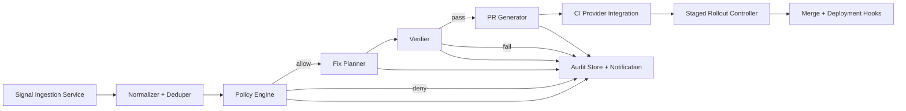

# ADR 0001: Automated Container Remediation Architecture and Policy Contract

- Status: Proposed
- Date: 2026-04-05
- Owners: Founding Engineer (Backend), CTO (review)
- Decision Scope: Signal ingestion, rule evaluation, fix planning, verification, and PR output for container remediation.

## Context

Container vulnerabilities are detected continuously, but remediation is currently manual and inconsistent. We need a system that:

- accepts scanner/runtime/container metadata signals,
- decides if/when a fix is allowed under policy,
- produces deterministic change plans,
- verifies fixes before merge,
- opens auditable pull requests with rollback-safe controls.

## Decision

Adopt an event-driven remediation pipeline with strict policy gating before any mutating action.

## Component Interfaces

### 1) Signal Ingestion Service

- Responsibility: Consume scanner and runtime findings.
- Input API:
  - `POST /v1/signals` (batch or single)
- Output: Normalized `FindingEvent` messages to queue.

### 2) Normalizer + Deduper

- Responsibility: Canonicalize package/image coordinates and collapse duplicate findings.
- Input: `FindingEvent`
- Output: `RemediationCandidate`

### 3) Policy Engine

- Responsibility: Evaluate candidate against policy contract.
- Input API:
  - `POST /v1/policy/evaluate`
- Output:
  - `PolicyDecision` with `allowed`, `reasons[]`, and `auditMetadata`

### 4) Fix Planner

- Responsibility: Convert allowed candidate into concrete patch plan.
- Input API:
  - `POST /v1/plans`
- Output:
  - `FixPlan` with file operations, package updates, and expected risk delta.

### 5) Verifier

- Responsibility: Run static checks + targeted tests in ephemeral environment.
- Input: `FixPlan`
- Output:
  - `VerificationResult` (`pass|fail`) with evidence artifacts.

### 6) PR Generator

- Responsibility: Create branch, commit(s), PR body, labels, and reviewer routing.
- Input API:
  - `POST /v1/pull-requests`
- Output:
  - `PullRequestEnvelope` (repo, branch, prNumber, links).

### 7) CI Provider Integration + Staged Rollout Controller

- Responsibility: Gate merge by environment, risk tier, and policy rollout controls.
- Input APIs:
  - `POST /v1/ci/checks`
  - `POST /v1/rollout/evaluate`
- Output:
  - `RolloutDecision` (`auto-merge|manual-approval|required-block`).

### 8) Audit Store

- Responsibility: Immutable audit trail for all policy decisions and side effects.
- Data retained:
  - decision inputs/outputs,
  - exception usage,
  - actor/service identity,
  - timestamps and correlation ids.

## Policy Contract

Policy is a versioned JSON schema contract:

- Schema: `schemas/policy-contract/v1.schema.json`
- Semantics:
  - risk levels: `low|medium|high|critical`
  - action controls: `allow[]` / `deny[]`
  - exception windows with explicit start/end and approver
  - mandatory audit metadata for every evaluation.

## API Boundaries

- Public control plane: `/v1/signals`, `/v1/policy/evaluate`, `/v1/plans`, `/v1/pull-requests`
- Internal async topics:
  - `remediation.candidate.created`
  - `remediation.policy.decided`
  - `remediation.plan.generated`
  - `remediation.verification.completed`
  - `remediation.pr.created`
- External integrations are adapter-based:
  - scanner adapters (e.g., Trivy, Grype)
  - VCS adapters (GitHub/GitLab)
  - CI adapters (GitHub Actions/CircleCI)

## Non-Goals

- Runtime patching of live containers.
- Cross-repository dependency graph remediation in v1.
- Autonomous merge for `critical` risk findings without policy override.

## Rollout Risks and Mitigations

- False-positive findings produce noisy PRs.
  - Mitigation: dedupe stage + minimum confidence threshold.
- Fixes can regress application behavior.
  - Mitigation: verifier requires policy-defined checks before PR creation.
- Policy misconfiguration can over-authorize actions.
  - Mitigation: schema validation + deny precedence + immutable audit logs.
- CI provider outage blocks automation.
  - Mitigation: staged fallback to manual approval mode.

## Consequences

- Positive: deterministic policy enforcement, stronger auditability, and scalable remediation throughput.
- Tradeoff: added service complexity and event orchestration overhead.
